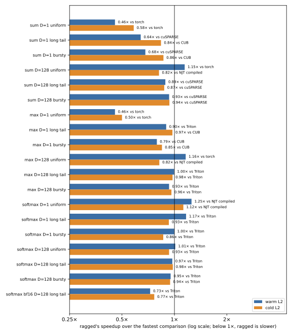

# ragged-mlir: an MLIR compiler for segmented reductions on ragged tensors

- An out-of-tree MLIR compiler that generates CUDA kernels for segmented sum,
  max and softmax over ragged tensors. Each call runs one of two compiled
  schedules, chosen by a calibrated cost model from N, B, D and the longest
  segment: a warp, block or multi-block mapping per segment chosen on the
  device, or one block per segment.
- On an RTX 4090, with a warm L2, it beats every comparison in 7 of 19
  workloads, is within 10% of the fastest in 5 and is more than 10% slower in
  7 (cold L2: 3, 7 and 9). The comparisons are autotuned Triton, CUB,
  `torch.segment_reduce`, NJT and a CUDA block-per-segment kernel. Its weakest
  cases are D=1 sum and max, where `torch.segment_reduce`, CUB or Triton is
  1.1 to 2.2 times faster, and the bf16 long-tail softmax, where Triton is 1.4
  times faster.
- The choice never costs more than noise against the compiler's own
  block-per-segment mode with a warm L2 (at most 1.4% over the 15 runs, 1.1%
  on the seed held out of calibration); with a cold L2 it is up to 5% slower
  on the three uniform D=128 workloads.
- Each time is the median of 15 processes (3 seeds of the length distribution
  × 5 repetitions). Every method passes a float64 oracle before it is timed.



Ragged (jagged) batches, a packed `[N, D]` tensor plus `B+1` segment offsets,
are how variable-length sequences, graph neighborhoods and recommendation
features reach a GPU. Reducing each segment (sum, max, softmax) is simple until
the lengths are skewed: one block per segment leaves most of the GPU idle on a
long segment, one warp per segment wastes it on short ones.

`ragged-mlir` is an out-of-tree compiler on MLIR 23.1.3 that generates CUDA
kernels (sm_89) for segmented sum, max and softmax, picks a mapping per
segment on the device, and chooses per call whether that classification is
worth its cost. It has its own dialect and passes, lowers through the GPU
and NVVM dialects to PTX and `ptxas`, caches compiled artifacts, and launches
them through the CUDA Driver API on PyTorch streams.

```python
from ragged import ArtifactCache, Compiler, ProgramSpec

program = Compiler("build/bin/ragged-compile").compile(
    ProgramSpec("softmax", dtype="bf16", feature_dim=128, offsets_dtype="i64"),
    ArtifactCache("~/.cache/ragged"))
program.run(values, offsets, out, max_len=longest)   # CUDA tensors; runs on the current stream
```

`max_len` (the longest segment, which a jagged tensor such as NJT carries)
lets the cost model choose the schedule; without it the program classifies
on the device.

## How it works

- **Dialect.** `ragged.segment_reduce` and `ragged.segment_softmax` over a
  `[N, D]` memref and i32/i64 offsets, with a semantics contract
  ([docs/semantics.md](docs/semantics.md)): f32 accumulation for f32 and bf16,
  NaN propagation and `-inf` identities for max, empty segments, exact output
  shapes. A verifier rejects ill-formed programs.
- **Mapping.** `ragged-legalize` makes accumulation, identity and NaN handling
  explicit. `ragged-plan` assigns segments to three classes by length: up to
  32 rows one warp (a shuffle tree, no shared memory), up to 4,096 rows one
  128-thread block, longer segments 8 blocks with partial results and a combine
  kernel. Caller-supplied `min_len`/`max_len` hints prune classes at
  compile time; otherwise a classify kernel bins segments into per-class
  worklists on the device, and persistent workers for each class drain them.
  Each warp of the classify kernel ranks its lanes per class with one shuffle
  scan and reserves its queue positions with at most three atomics.
- **Choosing per call.** Classification costs an init and a classify kernel,
  three worker chains (each launched even when its queue is empty) and a
  stream fork and join; one block per segment costs one launch but puts each
  segment on one block. A classifying program therefore also compiles the
  block-per-segment specialization, and before each call a linear cost model
  (`python/ragged/selection.py`) predicts both complete-call times from N, B,
  D, the longest segment and their skew, and runs the faster. Its
  coefficients are fitted on two seeds of the benchmark workloads
  (`bench/calibrate.py`, `results/bench/calibration/`) and evaluated on the
  third ([docs/design-tradeoffs.md](docs/design-tradeoffs.md)). The longest
  segment comes from the caller; without it the program classifies.
- **Scheduling.** Each persistent worker grid is one resident wave of that
  kernel, measured with the occupancy API when the module loads (on an RTX
  4090, up to 1,536 128-thread blocks or 3,072 warps, fewer for kernels with
  more registers, divided among feature tiles and split parts). The three classes touch disjoint segments, so their worker
  chains run on separate streams between a fork after classification and a
  join on the caller's stream, the CTA chain submitted first
  ([docs/classified-abi.md](docs/classified-abi.md)). Why each of these
  choices was made, and what it costs, is in
  [docs/design-tradeoffs.md](docs/design-tradeoffs.md).
- **Softmax.** `ragged-fuse` chooses the statistics schedule per segment
  class. A warp or CTA class computes the maximum and exponential sum in one
  online pass and normalizes in a second pass, in one kernel. Each of a split
  segment's eight blocks computes the same online statistics for its part, a
  combine kernel merges the eight, and a normalization kernel writes the
  output: two reads of the rows instead of three. The online statistics are
  compensated sums against a reference that trails the maximum by at most
  one, so their accuracy does not depend on segment length and they need no
  length hints. In-place softmax uses three passes in every class, the
  schedule that separates reads from writes. Optional f32 scale and additive
  mask.
- **Lowering.** `ragged-to-gpu` emits the kernels with feature-dimension
  tiling (`d_tile`) and gives each thread `d_vector` adjacent features (four
  f32 or eight bf16 when D allows), read and written with one aligned 16-byte
  vector access per row, then the standard GPU → NVVM → PTX pipeline and
  `ptxas` produce a cubin. Compensated f32 summation keeps bf16 and f32 sums within the
  float64 oracle's tolerance. Each lane's row loop issues eight loads before
  folding them in row order, so eight loads are in flight per lane and the
  arithmetic, and therefore every result bit, is that of the one-row loop
  ([docs/optimizations.md](docs/optimizations.md)).
- **Artifacts and runtime.** The compiler writes a cubin and a manifest (kernel
  order, grids, workspace shapes, ptxas resource usage, toolchain provenance).
  The Python runtime validates tensors against the manifest, allocates one
  scratch buffer for all workspace on the consumer stream, and launches through
  a small C++ Driver API module (`runtime/`): one `dlopen`/`cuInit` per process,
  a launch plan per problem size that issues every kernel and the stream fork
  and join in one native call, and modules unloaded only after the work
  launched from them has finished (an event per stream that used them). A
  checked mode validates the offsets on the device before any main kernel runs.

## Results

**Correctness.** Numerical results in the GPU tests and the benchmark are
checked against a float64 NumPy oracle with dtype-specific tolerances
(`oracle/reference.py`). On an RTX 4090 (driver 595.99, CUDA 13.2); the GPU
and sanitizer runs are at the commit the benchmark measured
([results/tests/summary.txt](results/tests/summary.txt),
[results/sanitizer/summary.txt](results/sanitizer/summary.txt)):

| Suite | Result |
|---|---|
| GPU tests (`test/gpu`): every op, dtype, D in {1, 2, 6, 7, 12, 16, 24, 40, 128, 1024}, i32/i64 offsets, four length distributions, empty segments, masks, in-place, checked offsets, streams, CUDA graph capture, Driver API faults; both schedules of the adaptive program and its choice; vector access compared bitwise against one feature per thread, row pipelining and concurrent classes against the rolled, serial schedule; misaligned tensors rejected; online and three-pass softmax in every class, including 65,536-row segments; class queues read back for counts, membership and per-warp order; both Triton mappings and the CUDA and CUB comparisons | 2,132 passed; 164 FBGEMM cases skip (optional package not installed) |
| compute-sanitizer memcheck, racecheck, initcheck and synccheck on the classified, mask, checked-offsets, scheduling, selection and per-class softmax suites (671 tests, one process per suite and tool; racecheck skips eight stream-ordering tests that queue large matmuls) | 0 errors, 0 hazards |
| lit/FileCheck tests of the dialect, passes and lowering (`test/`) | 41 passed |
| host tests (`test/python`): cache, manifest validation, runtime contracts and stream schedule, cost model and schedule choice, benchmark harness, suite and summary | 1,163 passed |

**Speed.** Complete-call GPU time in µs: CUDA events around the call, so host
launch gaps count. Each process times 30 calls after 5 warm-up calls; a cell
is the median over 15 processes (seeds 711 to 713 of the length distribution,
5 repetitions each) of each process's median, with the 25th to 75th
percentile below it (`bench/suite.py`, `bench/summarize.py`,
[results/bench/](results/bench/README.md)). f32 unless noted; 1M rows in
16,384 segments at D=1, 262,144 rows in 4,096 segments at D=128; uniform
(64 rows), long-tail (Pareto) and bursty lengths. **Warm** L2 is back-to-back
calls; **cold** L2 overwrites a 288 MiB buffer and synchronizes before every
call. Clocks are not locked: each run records `nvidia-smi` state (SM clock
2,520 to 2,805 MHz over the suite), and the host ran other work at the same
time. Each method passes the oracle before it is timed. The methods
([baselines/README.md](baselines/README.md)):

- `ragged`: the adaptive program. Each call it runs device classification or
  one block per segment, whichever the cost model predicts faster, given the
  exact longest segment length (`max_len`), the bound NJT also receives.
  *chose* lists the schedule per seed 711/712/713: C classification, N one
  block per segment.
- `ragged, classified`: the same program with classification forced
  (`select="classified"`), which is also what it runs without `max_len`.
- `ragged-naive`: this compiler with one block per segment (`strategy="naive"`).
- `torch.segment_reduce` from PyTorch 2.14 (sum and max).
- Triton 3.8: one program per segment, or segments cut into chunks of a
  tuned row count with a combine kernel; online softmax. The first call on
  each input times 8 (D=1) or 16 (D=128) configurations on that input and
  keeps the fastest, which favors Triton.
- CUB 3.5 `DeviceSegmentedReduce` at D=1; its softmax is CUB's max, an
  element-parallel exp, CUB's sum and an element-parallel division.
- A CUDA kernel with one 256-thread block per segment, threads over rows and
  up to 32 feature columns.
- NJT (`torch.nested`), compiled with `torch.compile(fullgraph=True)` and
  eager, built with the exact minimum and maximum sequence lengths.

Warm L2:

| Op | D | Lengths | ragged | chose | ragged, classified | ragged-naive | torch.segment_reduce | Triton (tuned) | CUB | CUDA, block per segment | NJT compiled | NJT eager |
|---|---:|---|---:|---|---:|---:|---:|---:|---:|---:|---:|---:|
| sum | 1 | uniform | 33 <sub>33–34</sub> | N/N/N | 48 <sub>48–49</sub> | 34 <sub>33–34</sub> | 15 <sub>15–15</sub> | 33 <sub>32–33</sub> | 30 <sub>30–30</sub> | 42 <sub>42–42</sub> | 28 <sub>28–29</sub> | 147 <sub>145–150</sub> |
| sum | 1 | long tail | 35 <sub>34–46</sub> | C/N/N | 44 <sub>42–45</sub> | 34 <sub>34–83</sub> | 638 <sub>512–5,356</sub> | 33 <sub>32–69</sub> | 29 <sub>28–47</sub> | 42 <sub>40–165</sub> | 284 <sub>238–2,176</sub> | 10,178 <sub>9,032–11,273</sub> (10 runs) |
| sum | 1 | bursty | 33 <sub>33–33</sub> | N/N/N | 39 <sub>39–39</sub> | 32 <sub>31–33</sub> | 235 <sub>229–240</sub> | 30 <sub>30–30</sub> | 25 <sub>25–25</sub> | 38 <sub>38–39</sub> | 75 <sub>75–77</sub> | 2,232 <sub>2,230–2,235</sub> |
| sum | 128 | uniform | 130 <sub>129–132</sub> | C/C/C | 132 <sub>130–136</sub> | 167 <sub>167–168</sub> | 155 <sub>155–156</sub> | 167 <sub>167–168</sub> | – | 161 <sub>161–161</sub> | 163 <sub>163–163</sub> | 565 <sub>562–567</sub> |
| sum | 128 | long tail | 189 <sub>189–193</sub> | C/N/C | 191 <sub>187–192</sub> | 196 <sub>189–199</sub> | 661 <sub>570–719</sub> | 185 <sub>184–185</sub> | – | 1,188 <sub>1,011–1,285</sub> | 1,114 <sub>1,009–1,126</sub> | fails |
| sum | 128 | bursty | 168 <sub>168–169</sub> | N/N/N | 180 <sub>179–181</sub> | 169 <sub>168–169</sub> | 482 <sub>476–484</sub> | 171 <sub>170–171</sub> | – | 914 <sub>911–915</sub> | 757 <sub>756–817</sub> | fails |
| max | 1 | uniform | 33 <sub>33–33</sub> | N/N/N | 48 <sub>48–48</sub> | 33 <sub>33–33</sub> | 15 <sub>15–15</sub> | 31 <sub>30–31</sub> | 32 <sub>32–32</sub> | 42 <sub>41–42</sub> | 29 <sub>28–29</sub> | 114 <sub>113–116</sub> |
| max | 1 | long tail | 34 <sub>33–43</sub> | C/N/N | 42 <sub>42–43</sub> | 34 <sub>33–53</sub> | 459 <sub>353–3,790</sub> | 30 <sub>29–49</sub> | 31 <sub>30–52</sub> | 42 <sub>40–158</sub> | 311 <sub>266–2,299</sub> | 10,138 <sub>9,029–10,857</sub> (10 runs) |
| max | 1 | bursty | 33 <sub>32–33</sub> | N/N/N | 39 <sub>39–40</sub> | 33 <sub>33–34</sub> | 158 <sub>112–159</sub> | 29 <sub>28–29</sub> | 26 <sub>25–26</sub> | 38 <sub>38–38</sub> | 82 <sub>81–83</sub> | 2,208 <sub>2,206–2,210</sub> |
| max | 128 | uniform | 132 <sub>130–138</sub> | C/C/C | 133 <sub>130–134</sub> | 168 <sub>167–168</sub> | 156 <sub>155–156</sub> | 167 <sub>166–168</sub> | – | 161 <sub>161–161</sub> | 162 <sub>162–163</sub> | 536 <sub>535–538</sub> |
| max | 128 | long tail | 183 <sub>181–186</sub> | C/N/C | 180 <sub>178–181</sub> | 192 <sub>188–197</sub> | 324 <sub>291–340</sub> | 181 <sub>179–181</sub> | – | 1,140 <sub>990–1,230</sub> | 1,139 <sub>1,138–1,230</sub> | fails |
| max | 128 | bursty | 167 <sub>167–168</sub> | N/N/N | 180 <sub>179–181</sub> | 168 <sub>167–169</sub> | 266 <sub>222–266</sub> | 170 <sub>169–170</sub> | – | 901 <sub>899–903</sub> | 910 <sub>908–926</sub> | fails |
| softmax | 1 | uniform | 35 <sub>35–36</sub> | N/N/N | 55 <sub>54–55</sub> | 35 <sub>35–36</sub> | – | 46 <sub>46–46</sub> | 75 <sub>75–75</sub> | 59 <sub>59–59</sub> | 47 <sub>47–48</sub> | 164 <sub>162–167</sub> |
| softmax | 1 | long tail | 54 <sub>51–81</sub> | C/N/C | 54 <sub>53–81</sub> | 56 <sub>51–263</sub> | – | 65 <sub>62–93</sub> | 72 <sub>71–110</sub> | 84 <sub>74–494</sub> | 677 <sub>563–5,418</sub> | 12,566 <sub>11,017–13,504</sub> (10 runs) |
| softmax | 1 | bursty | 36 <sub>35–37</sub> | N/N/N | 46 <sub>46–47</sub> | 36 <sub>35–37</sub> | – | 36 <sub>35–39</sub> | 62 <sub>61–62</sub> | 54 <sub>54–54</sub> | 167 <sub>166–167</sub> | 2,649 <sub>2,646–2,656</sub> |
| softmax | 128 | uniform | 310 <sub>308–312</sub> | C/C/C | 310 <sub>309–311</sub> | 321 <sub>320–321</sub> | – | 314 <sub>313–315</sub> | – | 314 <sub>313–314</sub> | 458 <sub>457–458</sub> | 1,194 <sub>1,193–1,195</sub> |
| softmax | 128 | long tail | 403 <sub>401–409</sub> | C/C/C | 404 <sub>399–406</sub> | 485 <sub>461–506</sub> | – | 392 <sub>385–392</sub> | – | 2,438 <sub>2,071–2,700</sub> | 4,436 <sub>3,703–4,715</sub> | fails |
| softmax | 128 | bursty | 506 <sub>505–507</sub> | C/C/C | 506 <sub>504–506</sub> | 506 <sub>505–508</sub> | – | 479 <sub>478–480</sub> | – | 1,937 <sub>1,926–1,944</sub> | 3,428 <sub>3,424–3,438</sub> | fails |
| softmax bf16 | 128 | long tail | 305 <sub>300–309</sub> | C/C/C | 302 <sub>294–307</sub> | 459 <sub>427–472</sub> | – | 220 <sub>220–222</sub> | – | 2,872 <sub>2,486–3,144</sub> | 4,264 <sub>3,785–4,791</sub> | fails |

Cold L2:

| Op | D | Lengths | ragged | chose | ragged, classified | ragged-naive | torch.segment_reduce | Triton (tuned) | CUB | CUDA, block per segment | NJT compiled | NJT eager |
|---|---:|---|---:|---|---:|---:|---:|---:|---:|---:|---:|---:|
| sum | 1 | uniform | 36 <sub>36–37</sub> | N/N/N | 55 <sub>54–56</sub> | 36 <sub>36–37</sub> | 22 <sub>21–22</sub> | 34 <sub>34–35</sub> | 34 <sub>34–34</sub> | 45 <sub>45–45</sub> | 31 <sub>30–32</sub> | 152 <sub>150–153</sub> |
| sum | 1 | long tail | 45 <sub>42–63</sub> | C/N/N | 54 <sub>54–63</sub> | 44 <sub>42–131</sub> | 1,208 <sub>986–9,560</sub> | 44 <sub>42–80</sub> | 35 <sub>35–74</sub> | 61 <sub>55–316</sub> | 287 <sub>239–2,192</sub> | 9,851 <sub>8,870–10,878</sub> (10 runs) |
| sum | 1 | bursty | 37 <sub>37–38</sub> | N/N/N | 50 <sub>50–51</sub> | 37 <sub>37–38</sub> | 519 <sub>517–528</sub> | 35 <sub>33–35</sub> | 32 <sub>31–32</sub> | 42 <sub>41–43</sub> | 79 <sub>77–80</sub> | 2,230 <sub>2,168–2,241</sub> |
| sum | 128 | uniform | 229 <sub>229–230</sub> | C/C/C | 229 <sub>228–230</sub> | 218 <sub>218–219</sub> | 207 <sub>207–207</sub> | 219 <sub>218–219</sub> | – | 212 <sub>212–213</sub> | 189 <sub>189–190</sub> | 620 <sub>615–621</sub> |
| sum | 128 | long tail | 248 <sub>241–252</sub> | C/N/C | 249 <sub>244–251</sub> | 247 <sub>241–251</sub> | 718 <sub>624–779</sub> | 236 <sub>235–236</sub> | – | 1,236 <sub>1,062–1,337</sub> | 1,121 <sub>1,026–1,130</sub> | fails |
| sum | 128 | bursty | 224 <sub>223–224</sub> | N/N/N | 232 <sub>232–233</sub> | 223 <sub>223–224</sub> | 538 <sub>530–538</sub> | 225 <sub>225–226</sub> | – | 961 <sub>960–962</sub> | 758 <sub>757–827</sub> | fails |
| max | 1 | uniform | 36 <sub>36–37</sub> | N/N/N | 56 <sub>55–56</sub> | 36 <sub>36–37</sub> | 18 <sub>18–18</sub> | 33 <sub>33–34</sub> | 36 <sub>36–36</sub> | 45 <sub>45–45</sub> | 31 <sub>31–32</sub> | 118 <sub>117–120</sub> |
| max | 1 | long tail | 39 <sub>39–59</sub> | C/N/N | 54 <sub>52–59</sub> | 40 <sub>39–80</sub> | 783 <sub>621–6,242</sub> | 43 <sub>41–76</sub> | 37 <sub>36–79</sub> | 60 <sub>55–311</sub> | 312 <sub>268–2,319</sub> | 9,827 <sub>8,838–10,800</sub> (10 runs) |
| max | 1 | bursty | 38 <sub>38–39</sub> | N/N/N | 51 <sub>50–51</sub> | 39 <sub>38–39</sub> | 225 <sub>214–227</sub> | 34 <sub>34–35</sub> | 33 <sub>32–34</sub> | 42 <sub>41–43</sub> | 85 <sub>83–86</sub> | 2,214 <sub>2,211–2,217</sub> |
| max | 128 | uniform | 229 <sub>228–229</sub> | C/C/C | 228 <sub>227–229</sub> | 218 <sub>218–219</sub> | 205 <sub>205–205</sub> | 218 <sub>218–219</sub> | – | 213 <sub>212–213</sub> | 189 <sub>189–189</sub> | 588 <sub>588–590</sub> |
| max | 128 | long tail | 238 <sub>237–239</sub> | C/N/C | 236 <sub>235–238</sub> | 244 <sub>239–248</sub> | 375 <sub>341–394</sub> | 232 <sub>230–233</sub> | – | 1,182 <sub>1,047–1,283</sub> | 1,162 <sub>1,161–1,247</sub> | fails |
| max | 128 | bursty | 223 <sub>223–224</sub> | N/N/N | 232 <sub>232–233</sub> | 223 <sub>223–224</sub> | 289 <sub>266–290</sub> | 225 <sub>224–226</sub> | – | 950 <sub>949–951</sub> | 918 <sub>910–927</sub> | fails |
| softmax | 1 | uniform | 41 <sub>40–41</sub> | N/N/N | 66 <sub>65–66</sub> | 41 <sub>41–41</sub> | – | 47 <sub>47–48</sub> | 77 <sub>76–77</sub> | 60 <sub>60–60</sub> | 48 <sub>48–49</sub> | 165 <sub>163–168</sub> |
| softmax | 1 | long tail | 70 <sub>69–101</sub> | C/N/C | 70 <sub>68–100</sub> | 78 <sub>70–351</sub> | – | 69 <sub>65–95</sub> | 80 <sub>73–110</sub> | 84 <sub>80–497</sub> | 678 <sub>567–5,267</sub> | 12,264 <sub>11,000–13,537</sub> (10 runs) |
| softmax | 1 | bursty | 45 <sub>44–47</sub> | N/N/N | 63 <sub>61–64</sub> | 45 <sub>43–47</sub> | – | 37 <sub>37–41</sub> | 64 <sub>63–65</sub> | 55 <sub>55–55</sub> | 169 <sub>168–169</sub> | 2,656 <sub>2,646–2,658</sub> |
| softmax | 128 | uniform | 346 <sub>346–347</sub> | C/C/C | 346 <sub>346–347</sub> | 331 <sub>331–331</sub> | – | 324 <sub>324–324</sub> | – | 331 <sub>330–331</sub> | 477 <sub>477–478</sub> | 1,222 <sub>1,220–1,223</sub> |
| softmax | 128 | long tail | 422 <sub>419–429</sub> | C/C/C | 423 <sub>421–432</sub> | 507 <sub>481–528</sub> | – | 412 <sub>404–413</sub> | – | 2,463 <sub>2,095–2,732</sub> | 4,089 <sub>3,718–4,475</sub> | fails |
| softmax | 128 | bursty | 518 <sub>517–520</sub> | C/C/C | 519 <sub>518–520</sub> | 521 <sub>520–522</sub> | – | 491 <sub>490–494</sub> | – | 1,956 <sub>1,950–1,975</sub> | 3,419 <sub>3,142–3,424</sub> | fails |
| softmax bf16 | 128 | long tail | 326 <sub>318–333</sub> | C/C/C | 329 <sub>318–334</sub> | 474 <sub>443–485</sub> | – | 247 <sub>245–248</sub> | – | 2,889 <sub>2,500–3,159</sub> | 3,989 <sub>3,798–4,364</sub> | fails |

On the long tail the seed sets the longest segment: 300,412 rows for seed
711 at D=1 and 29,049 and 35,765 for the others, so the upper quartile of a
D=1 long-tail cell is mostly seed 711. `summary.json` lists every seed's
median and chosen schedule.

What the numbers say:

- **Classification alone loses to one block per segment in 10 of 19 warm
  workloads (14 cold); the per-call choice removes those losses.** Forced
  classification is 19 to 55% slower on every D=1 workload but the long-tail
  softmax, and 7% slower on the bursty D=128 sum and max. The traces
  (`results/bench/profile.txt`) show why: on the uniform D=1 sum the
  classified GPU span is 30 µs (classify 6.5, the CTA workers 18.7, and the
  empty warp and split chains 2.7 to 2.8 µs each) against one 14.8 µs kernel,
  and its host side takes 24 µs against 14 (`results/bench/host.txt`: six
  launches, a stream fork and a join instead of one launch). On the bursty
  D=128 sum the 40 long segments already fill 160 blocks of one block per
  segment (149 µs), so splitting them (147 µs) buys nothing and the prologue
  and the warp chain beside it are extra. Classification wins where many
  short blocks or one long block hurt: the uniform D=128 sum, whose 16,384
  short blocks take 149 µs against 101 µs for persistent CTA workers, and
  long segments, such as seed 711's 300,412-row D=1 segment (sum 46 µs
  against 84, softmax 82 against 264).
- **The choice stays within noise of block per segment with a warm L2.**
  Over all 15 runs the adaptive median is at most 1.4% above `ragged-naive`
  (D=1 bursty sum, 32.7 against 32.3 µs, the same kernel); on the held-out
  seed 713 at most 1.1% (`results/bench/calibration/evaluation.txt`). Where it
  classifies it is 17 to 34% faster than block per segment on the uniform
  D=128 sum and max and the long-tail D=128 softmax (f32 and bf16).
- **With a cold L2 it is up to 5% slower than block per segment on uniform
  D=128 inputs.** The model is calibrated on warm times, where classification
  wins those three workloads (sum 130 against 167 µs); cold, block per
  segment is faster (sum 218 against 229, max 218 against 229, softmax 331
  against 346), and the model still classifies.
- **The cold D=128 uniform sum still reads at 0.59 TB/s, mostly because of
  the flush.** It takes 229 µs (block per segment 218) against 133 µs for
  reading 128 MiB at 1.01 TB/s. The benchmark's flush leaves the L2 full of
  dirty lines, which are written back while the call reads: after a flush
  that only reads, the same call takes 175 µs classified and 163 µs (0.82
  TB/s, host time included) block per segment, and `torch.segment_reduce` 152
  instead of 206 (`results/bench/cold-l2.txt`). Vector loads did not change
  the cold time (227 µs scalar). Compiled NJT stays the fastest cold
  uniform D=128 sum and max (189 µs).
- **Vector access helps block per segment and the f32 classified softmax,
  and hurts bf16.** With 16-byte accesses and four times the row lanes per
  block, one block per segment takes 196 µs instead of 236 on the long-tail
  D=128 sum, 485 instead of 572 on the long-tail softmax and 506 instead of
  534 on the bursty softmax; classification takes 404 instead of 437 on the
  long-tail softmax; elsewhere both schedules are within 4% of one feature
  per thread. On the bf16 long-tail softmax, where a thread owns eight
  features and its online CTA kernel needs 159 registers instead of 45 (3 blocks
  per SM), it is slower: 302 µs classified against 264 µs with one feature
  per thread, and block per segment 459 against 442.
- **The comparisons still win at D=1 and on skewed D=128 inputs.**
  `torch.segment_reduce` takes 15 µs on uniform sum and max, where ragged
  takes 33; CUB takes 25 to 29 µs on the long-tail and bursty sum and the
  bursty max (ragged 33 to 35), Triton 30 µs on the long-tail max (34) and
  36 on the bursty softmax (ragged 36, 1% slower). Tuned Triton is 1 to 6%
  faster on the long-tail D=128 sum, max and softmax and the bursty
  softmax, and 1.38 times faster on the bf16 long-tail softmax (220 against
  305 µs). ragged
  beats every comparison on the uniform D=128 sum, max and softmax, the
  bursty D=128 sum and max, and the uniform and long-tail D=1 softmax.
- **Length hints** are now mostly redundant: exact bounds still compile the
  uniform D=128 sum to one CTA class, which is block per segment (167 µs
  against 130), and the per-call choice already gives the D=1 workloads the
  block-per-segment time.
- **NJT** with exact sequence lengths compiles to fast code for uniform
  lengths (28 µs for the D=1 sum, the fastest cold D=128 uniform sum and max)
  and is 2 to 14 times slower than ragged on skewed ones. Eager NJT pads to the
  longest segment: it fails on an int32 index limit for skewed D=128 inputs
  and for seed 711 at D=1, and takes 0.1 to 12.6 ms elsewhere.

**Ablations**, warm, µs (`results/bench/runs/ablation/`), each turning off
one optimization of the classified schedule in the same build:
`--disable-optimization online_fusion` (three passes in every class),
`--disable-optimization row_pipelining` and `--serial-classes`:

| Workload | ragged, classified | three passes in every class | rows not pipelined | classes serial |
|---|---:|---:|---:|---:|
| sum, D=1, uniform | 48 <sub>48–49</sub> | – | 49 <sub>48–49</sub> | 55 <sub>55–56</sub> |
| sum, D=1, long tail | 44 <sub>42–45</sub> | – | 44 <sub>43–49</sub> | 49 <sub>49–50</sub> |
| sum, D=1, bursty | 39 <sub>39–39</sub> | – | 39 <sub>39–40</sub> | 42 <sub>42–43</sub> |
| sum, D=128, uniform | 132 <sub>130–136</sub> | – | 134 <sub>130–136</sub> | 136 <sub>135–137</sub> |
| sum, D=128, long tail | 191 <sub>187–192</sub> | – | 192 <sub>189–195</sub> | 202 <sub>198–203</sub> |
| sum, D=128, bursty | 180 <sub>179–181</sub> | – | 182 <sub>182–182</sub> | 184 <sub>183–185</sub> |
| max, D=1, uniform | 48 <sub>48–48</sub> | – | 48 <sub>48–49</sub> | 55 <sub>55–56</sub> |
| max, D=1, long tail | 42 <sub>42–43</sub> | – | 44 <sub>43–48</sub> | 49 <sub>49–50</sub> |
| max, D=1, bursty | 39 <sub>39–40</sub> | – | 40 <sub>39–40</sub> | 43 <sub>43–43</sub> |
| max, D=128, uniform | 133 <sub>130–134</sub> | – | 134 <sub>132–136</sub> | 136 <sub>134–137</sub> |
| max, D=128, long tail | 180 <sub>178–181</sub> | – | 189 <sub>187–190</sub> | 189 <sub>187–189</sub> |
| max, D=128, bursty | 180 <sub>179–181</sub> | – | 181 <sub>181–182</sub> | 183 <sub>183–184</sub> |
| softmax, D=1, uniform | 55 <sub>54–55</sub> | 79 <sub>79–80</sub> | 53 <sub>52–53</sub> | 60 <sub>60–61</sub> |
| softmax, D=1, long tail | 54 <sub>53–81</sub> | 68 <sub>67–89</sub> | 55 <sub>54–107</sub> | 65 <sub>63–92</sub> |
| softmax, D=1, bursty | 46 <sub>46–47</sub> | 59 <sub>58–59</sub> | 48 <sub>47–48</sub> | 53 <sub>52–53</sub> |
| softmax, D=128, uniform | 310 <sub>309–311</sub> | 624 <sub>623–624</sub> | 310 <sub>309–312</sub> | 321 <sub>320–322</sub> |
| softmax, D=128, long tail | 404 <sub>399–406</sub> | 631 <sub>629–633</sub> | 493 <sub>479–508</sub> | 451 <sub>442–457</sub> |
| softmax, D=128, bursty | 506 <sub>504–506</sub> | 651 <sub>651–653</sub> | 505 <sub>504–506</sub> | 511 <sub>510–512</sub> |
| softmax bf16, D=128, long tail | 302 <sub>294–307</sub> | – | – | – |

Online statistics are faster in every softmax workload: three passes take
26 to 101% longer. Concurrent class chains are faster in every f32 workload:
serial chains take 1 to 20% longer. Row pipelining helps the long-tail
D=128 workloads most (max 189 against 180 µs, softmax 493 against 404) and is
slower in three: the uniform D=1 softmax by 3%, the uniform and bursty D=128
softmax by 0.1 to 0.2%.

**Vector access** (`--disable-optimization vectorize`, both schedules, D=128),
µs:

| Workload | classified | classified, scalar | naive | naive, scalar |
|---|---:|---:|---:|---:|
| sum, D=128, uniform, warm | 132 <sub>130–136</sub> | 135 <sub>130–138</sub> | 167 <sub>167–168</sub> | 166 <sub>166–166</sub> |
| sum, D=128, uniform, cold | 229 <sub>228–230</sub> | 227 <sub>227–228</sub> | 218 <sub>218–219</sub> | 216 <sub>216–217</sub> |
| sum, D=128, long tail, warm | 191 <sub>187–192</sub> | 195 <sub>192–196</sub> | 196 <sub>189–199</sub> | 236 <sub>223–244</sub> |
| sum, D=128, long tail, cold | 249 <sub>244–251</sub> | 251 <sub>248–254</sub> | 247 <sub>241–251</sub> | 289 <sub>274–298</sub> |
| sum, D=128, bursty, warm | 180 <sub>179–181</sub> | 181 <sub>180–181</sub> | 169 <sub>168–169</sub> | 170 <sub>170–171</sub> |
| sum, D=128, bursty, cold | 232 <sub>232–233</sub> | 231 <sub>231–232</sub> | 223 <sub>223–224</sub> | 226 <sub>226–227</sub> |
| max, D=128, uniform, warm | 133 <sub>130–134</sub> | 138 <sub>132–140</sub> | 168 <sub>167–168</sub> | 166 <sub>166–166</sub> |
| max, D=128, uniform, cold | 228 <sub>227–229</sub> | 227 <sub>227–228</sub> | 218 <sub>218–219</sub> | 215 <sub>215–216</sub> |
| max, D=128, long tail, warm | 180 <sub>178–181</sub> | 184 <sub>182–186</sub> | 192 <sub>188–197</sub> | 195 <sub>188–198</sub> |
| max, D=128, long tail, cold | 236 <sub>235–238</sub> | 241 <sub>239–243</sub> | 244 <sub>239–248</sub> | 247 <sub>241–250</sub> |
| max, D=128, bursty, warm | 180 <sub>179–181</sub> | 181 <sub>181–181</sub> | 168 <sub>167–169</sub> | 167 <sub>166–168</sub> |
| max, D=128, bursty, cold | 232 <sub>232–233</sub> | 232 <sub>231–233</sub> | 223 <sub>223–224</sub> | 222 <sub>222–223</sub> |
| softmax, D=128, uniform, warm | 310 <sub>309–311</sub> | 314 <sub>313–315</sub> | 321 <sub>320–321</sub> | 335 <sub>335–336</sub> |
| softmax, D=128, uniform, cold | 346 <sub>346–347</sub> | 346 <sub>346–347</sub> | 331 <sub>331–331</sub> | 343 <sub>343–344</sub> |
| softmax, D=128, long tail, warm | 404 <sub>399–406</sub> | 437 <sub>429–443</sub> | 485 <sub>461–506</sub> | 572 <sub>528–598</sub> |
| softmax, D=128, long tail, cold | 423 <sub>421–432</sub> | 458 <sub>451–472</sub> | 507 <sub>481–528</sub> | 593 <sub>551–622</sub> |
| softmax, D=128, bursty, warm | 506 <sub>504–506</sub> | 506 <sub>506–510</sub> | 506 <sub>505–508</sub> | 534 <sub>523–549</sub> |
| softmax, D=128, bursty, cold | 519 <sub>518–520</sub> | 518 <sub>517–520</sub> | 521 <sub>520–522</sub> | 542 <sub>534–593</sub> |
| softmax bf16, D=128, long tail, warm | 302 <sub>294–307</sub> | 264 <sub>260–275</sub> | 459 <sub>427–472</sub> | 442 <sub>396–469</sub> |
| softmax bf16, D=128, long tail, cold | 329 <sub>318–334</sub> | 301 <sub>299–319</sub> | 474 <sub>443–485</sub> | 469 <sub>425–498</sub> |

**Length hints** (`--length-hints`, exact bounds), warm, µs:

| Workload | ragged | ragged with exact length hints | classes with hints | ragged-naive |
|---|---:|---:|---|---:|
| softmax, D=1, uniform | 35 <sub>35–36</sub> | 36 <sub>35–36</sub> | cta | 35 <sub>35–36</sub> |
| softmax, D=128, uniform | 310 <sub>308–312</sub> | 321 <sub>321–321</sub> | cta | 321 <sub>320–321</sub> |
| sum, D=1, long tail | 35 <sub>34–46</sub> | 35 <sub>34–46</sub> | warp+cta+split | 34 <sub>34–83</sub> |
| sum, D=1, uniform | 33 <sub>33–34</sub> | 33 <sub>33–33</sub> | cta | 34 <sub>33–34</sub> |
| sum, D=128, long tail | 189 <sub>189–193</sub> | 193 <sub>191–194</sub> | warp+cta+split | 196 <sub>189–199</sub> |
| sum, D=128, uniform | 130 <sub>129–132</sub> | 167 <sub>167–168</sub> | cta | 167 <sub>167–168</sub> |

**Kernel traces** (`results/bench/profile.txt`, seed 711). With uniform
lengths at D=128 every 64-row segment is in the CTA class, whose online
softmax kernel takes 281 µs warm to read and write 128 MiB each. On the D=128
long-tail softmax the CTA, warp and split classes take 291, 68 and 39 µs run
one after another; concurrently the call's GPU span is 398 µs instead of 428,
although every kernel runs longer while they share the GPU. Cold, the CTA
kernel of the uniform D=128 sum takes 200 µs against 101 warm.

## Build and run

LLVM/MLIR 23.1.3 (`scripts/bootstrap_llvm.sh` builds it), CUDA 13.2 with
`ptxas`, CMake, Ninja, Python 3.12 with PyTorch 2.14 (CUDA 13.2 build) and
nanobind.

```sh
scripts/bootstrap_llvm.sh          # builds LLVM/MLIR in .deps/llvm-build, writes .deps/ragged-source-sdk.cmake
cmake -G Ninja -C .deps/ragged-source-sdk.cmake -S . -B build
ninja -C build && ninja -C build check-ragged          # compiler and lit tests
cmake -S runtime -B build-runtime && cmake --build build-runtime && cmake --install build-runtime --prefix python
python -m pytest                                       # host tests (test/python); a CPU PyTorch is enough
PYTHONPATH=python RAGGED_COMPILE=build/bin/ragged-compile python -m pytest test/gpu
PYTHONPATH=python:. python -m bench.run --op softmax --dtype bf16 --d 128 \
  --distribution long_tail --segments 4096 --total-elements 262144 \
  --output build/bench/softmax-bf16-d128-long_tail
```

With the official LLVM 23.1.3 Linux SDK instead of a source build (how the
published results were built), configure with
`-DMLIR_DIR=<sdk>/lib/cmake/mlir` and point
`-DRAGGED_LLVM_TEST_TOOLS_DIR` at a directory holding `FileCheck` and `not`,
which the SDK does not ship ([docs/provenance.md](docs/provenance.md)).

`bench.run` refuses an output directory that is not empty, so the command
above writes a new one under `build/`; compare it with
`results/bench/runs/main/softmax-bf16-d128-long_tail/seed-711/`. The
`cuda-naive` and `cub` methods need the comparison library that
`baselines/README.md` shows how to build. The cost model's calibration, the
whole suite (1,155 processes), its summary, the held-out evaluation and the
chart:

```sh
python -m bench.suite --groups main --seeds 711 712 --methods ragged-classified ragged-naive \
    --output build/calibration --lock /var/tmp/gpu.lock --lock-batch 600
python -m bench.calibrate fit build/calibration --train 711 712 --output python/ragged/cost_model.json
python -m bench.suite --output build/runs --lock /var/tmp/gpu.lock --lock-batch 600
python -m bench.summarize build/runs --output build/summary.json
python -m bench.calibrate evaluate build/runs --seeds 713
python -m bench.chart build/summary.json --output build/speedup.svg
```

## Limitations

- sm_89 only; one device per program; forward only (no autograd).
- Validated mode trusts the offsets; checked mode validates them on the device
  at the cost of a stream synchronization before the main kernels.
- The schedule choice needs the longest segment length from the caller
  (`max_len`); without it the program always classifies, which is 19 to 55%
  slower than one block per segment at D=1 (the `ragged, classified`
  column). Computing the statistics on the device would need a readback and a
  synchronization per call. A wrong `max_len` costs time, not correctness.
- The cost model is linear in six terms and calibrated on warm times of the
  benchmark's 19 workloads (two shapes, three length distributions) on one
  GPU. With a cold L2 it picks classification for the uniform D=128 inputs
  where block per segment is 5% faster; other shapes, distributions and GPUs
  are not calibrated.
- Segment-class bounds (32 and 4,096 rows) and the 8-way split are fixed in the
  compiler and the classified ABI, not tuned per GPU or per D.
- Vector access makes the bf16 long-tail softmax slower (302 against 264 µs
  classified) and needs 16-byte-aligned tensors; a view that starts mid-row
  needs a `vectorize=False` specialization.
- Host time is 24 to 26 µs per classified call and 14 to 15 µs per
  block-per-segment call (`results/bench/host.txt`): tensor validation,
  descriptor construction and the scratch allocation in Python, then one
  native call. `torch.segment_reduce` and CUB remain faster at D=1.
- The online fold is one dependency chain per lane. When few segments are
  long, as for the split class of the long-tail inputs, its kernel is bound by
  latency rather than bandwidth. Recentering once per batch of eight pipelined
  rows would shorten the chain, but would change results against the rolled
  loop, which row pipelining now reproduces bit for bit.
- Tuned Triton is 1 to 6% faster on skewed D=128 f32 inputs and 1.38 times
  faster on the bf16 long-tail softmax.
- With a cold L2 the D=128 uniform sum reads its input at 0.59 TB/s. Most of
  the gap to DRAM bandwidth is the write-back of the dirty lines the
  benchmark's flush leaves in the L2 (`results/bench/cold-l2.txt`), which
  every method pays; compiled NJT is still 1.2 times faster there.
- Persistent workers take queue positions with a fixed stride, so their speed
  depends on the order classification leaves in the queues and on which SM
  each worker lands. In separate A/B runs (not part of `results/`), the
  warp-ordered queues made the long-tail D=128 sum and max about 6% slower
  than per-segment atomics, and submitting the split chain before the CTA
  chain made the uniform D=128 sum take 176 µs instead of 133
  ([docs/design-tradeoffs.md](docs/design-tradeoffs.md)).
- One GPU (an RTX 4090 that also drives a desktop and is shared with other
  projects), unlocked clocks, and a host running other work; synthetic length
  distributions plus three seeds. The Triton reference is tuned on each
  benchmark input, but FBGEMM and `torch_scatter` are not measured.

## Layout

| Path | What it is |
|---|---|
| `include/Ragged/`, `lib/IR/` | the dialect, ops and verifiers |
| `lib/Transforms/` | legalization and mapping selection |
| `lib/Conversion/ToGPU.cpp` | lowering to GPU kernels |
| `tools/` | `ragged-opt` and `ragged-compile` |
| `python/ragged/` | frontend, artifact cache, manifest validation, runtime, schedule cost model (`selection.py`, `cost_model.json`), PyTorch op registration |
| `runtime/` | CUDA Driver API module loader and launcher (nanobind) |
| `oracle/` | float64 reference and test-case minimizer |
| `baselines/`, `bench/` | comparison implementations and the benchmark harness |
| `scripts/` | `bootstrap_llvm.sh` (LLVM/MLIR source build) and `build_baselines.py` (the CUDA/CUB comparison library) |
| `test/` | lit tests (`IR`, `Transforms`, `Conversion`), host tests, GPU tests |
| `docs/` | semantics, ABIs, optimizations, error model, design trade-offs |
| `results/` | benchmark runs and summary, cost-model calibration and evaluation, traces, test and sanitizer summaries |
